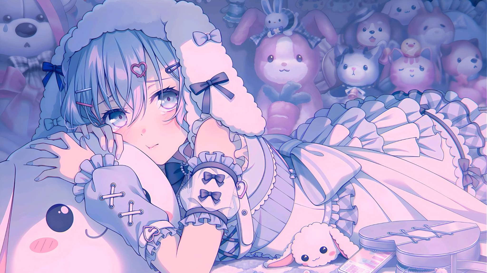
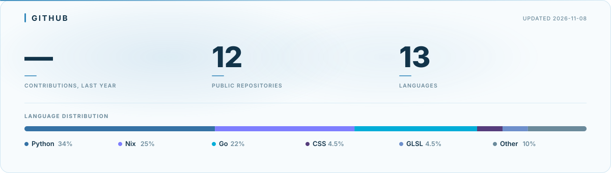

  

##  About

I'm Ryoko, a computer science researcher. I work on reinforcement learning, distributed systems, and the lower layers of the stack.

**Research:** Reinforcement learning, with an interest in offline RL.  
**Systems:** Go services, Linux, concurrency, distributed architecture.  
**Competitive programming:** Algorithms and data structures.  
**Community:** Member of [@mcpp-community](https://github.com/mcpp-community).

##  Toolchain

  &nbsp;&nbsp;&nbsp;
  &nbsp;&nbsp;&nbsp;
  &nbsp;&nbsp;&nbsp;
  &nbsp;&nbsp;&nbsp;
  
    
  &nbsp;&nbsp;&nbsp;
  &nbsp;&nbsp;&nbsp;
  &nbsp;&nbsp;&nbsp;
  &nbsp;&nbsp;&nbsp;
  
    
  &nbsp;&nbsp;&nbsp;
  &nbsp;&nbsp;&nbsp;
  &nbsp;&nbsp;&nbsp;
  &nbsp;&nbsp;&nbsp;
  

##  GitHub

  <picture>
    <source media="(prefers-color-scheme: dark)" srcset="assets/generated/metrics-dark.svg">
    
  </picture>

Updated automatically from the GitHub API.

##  Selected Work

### <a href="https://github.com/Shinonome-Ryoko14/Distributed-Seckill">Distributed-Seckill</a>
A distributed flash-sale system built around Redis, Kafka, and Go.  
Go · Gin · MySQL · Redis · Kafka · Prometheus

### <a href="https://github.com/Shinonome-Ryoko14/harmony-eldercare">harmony-eldercare</a>
An OpenHarmony elder-care app with realtime monitoring, alert handling, and AI care briefings.  
ArkTS · Python · HTTP

### <a href="https://github.com/Shinonome-Ryoko14/Club-System">Club-System</a>
A club project management system and my first proper Go backend.  
Go · Gin · GORM · MySQL

### <a href="https://github.com/Shinonome-Ryoko14/win-local-intelligent-assistant">win-local-intelligent-assistant</a>
A Windows local assistant with global hotkeys, command routing, and AI enhancement.  
C++ · Win32

##  Contact

  <a href="https://github.com/Shinonome-Ryoko14">GitHub · Shinonome-Ryoko14</a>
  &nbsp;&nbsp;·&nbsp;&nbsp;
  <a href="https://orcid.org/0009-0009-2859-748X">ORCID · 0009-0009-2859-748X</a>
  &nbsp;&nbsp;·&nbsp;&nbsp;
  <a href="https://space.bilibili.com/496883889">Bilibili · 496883889</a>

