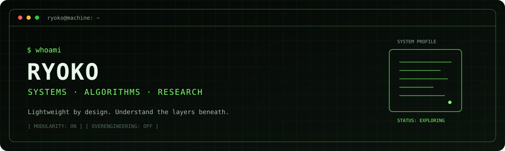

<div align="center">



<br>

**OMNIVOROUS GEEK · ACMER · COMPUTER SCIENCE RESEARCHER**

*Algorithms · Systems Programming · Concurrency · Reinforcement Learning · Go · Software Architecture · DevOps*

<br>

> **“Make the machine truly yours. A true computer geek must fully understand and command the machine they operate.”**

<br>

[](https://github.com/Shinonome-Ryoko14)
[](https://go.dev/)
[](https://kernel.org/)
[](https://www.python.org/)
[](https://isocpp.org/)

</div>

---

## `whoami`

A multidisciplinary computer geek exploring the layers between algorithms, operating systems, and production software.

I enjoy understanding how things work beneath the abstractions—and turning that understanding into software that is **lightweight, simple, and high-performance**.

- **Competitive programming:** algorithms and data structures
- **Systems:** Linux, systems programming, and concurrency
- **Research:** reinforcement learning, with an interest in offline RL
- **Engineering:** Go backend services, software architecture, and DevOps

## `principles`

```text
> Keep it lightweight.
> Prefer simplicity over unnecessary complexity.
> Build modular systems with loose coupling.
> Understand the mechanisms beneath the abstractions.
> Make performance a consequence of good engineering.
```

## `featured-projects`

<div align="center">

<a href="https://github.com/Shinonome-Ryoko14/Distributed-Seckill">
  
</a>

</div>

**Distributed-Seckill** — a high-concurrency distributed flash-sale system.  
Go · Gin · MySQL · Redis/Lua · Kafka · Prometheus · k6

> Keep traffic away from the database. Decouple order creation from the flash-sale request.

*Add or replace project cards as your other repositories become ready to showcase.*

## `toolchain`

<div align="center">


</div>

<details>
<summary><code>runtime --environment</code></summary>

- **Languages:** Go, C++, Python
- **Backend & data:** Gin, MySQL, Redis, Kafka
- **Research & computation:** PyTorch, NumPy
- **Infrastructure & workflow:** Linux, Docker, Git, shell tooling

</details>

## `github-metrics`

<div align="center">


</div>

<div align="center">


</div>

---

<div align="center">

```text
[ SYSTEM STATUS: EXPLORING ]
```

*Understand the machine. Respect the constraints. Build with intent.*

</div>
